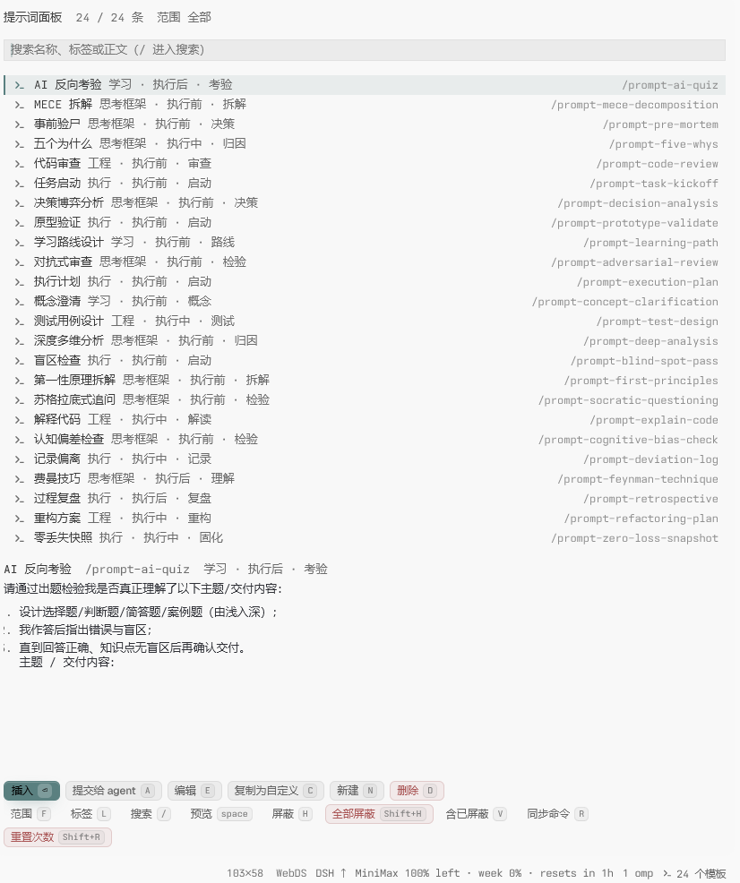

# tern-prompt-panel

[Tern](https://tern.build) 的提示词面板：预制与自定义模板的可视化增删改查，并把每个模板绑成一条 omp 斜杠命令。



## 安装

```sh
tern plugin install git@github.com:meisijiya/tern-prompt-panel.git
tern plugin list      # 末尾应为 "ready"
```

开发时用链接代替拷贝，改完 `tern plugin reload tern-prompt-panel` 即生效：

```sh
tern plugin link /path/to/tern-prompt-panel
```

## 打开

命令面板里的 **提示词面板**，或点状态栏右侧的“N 个模板”。每次都是**新开一个面板**：
面板只服务它旁边的 agent（同一 tab 里离它最近的 agent 块），所以可以给每个 agent 配一个，
互不干扰；旁边没有 agent 时才退回最近聚焦的那个。

## 键盘

删除不会立刻消失得没影：删掉的模板留在撤回槽里，按 `u` 或点「撤回删除」就回来（含命令文件）；
撤回槽只记一条，删下一条时旧的作废；关掉面板再打开就清空。

选中任意模板，正文就显示在列表下面（`空格` 收起或展开）。面板底部的按钮就是全部快捷键，
按钮上画着键帽，颜色区分主操作（填充）、常规（描边）、工具（无边框）和危险（红）；面板窄了会自己折行，不裁按钮。

列表：

| 键 | 作用 |
| --- | --- |
| `Enter` | 插入：复制正文，并打进面板旁边那个 agent 的输入框 |
| `a` | 提交给面板旁边那个 agent（直接发送） |
| `空格` | 收起 / 展开正文预览 |
| `e` / `c` | 编辑 / 复制为自定义模板 |
| `n` / `d` | 新建 / 删除自定义模板 |
| `u` | 撤回最近一次删除（按钮也只在有东西可撤回时出现） |
| `f` / `l` | 切换范围（全部·预制·自定义）/ 切换标签 |
| `h` / `Shift+H` | 屏蔽这一条 / 屏蔽全部预制模板 |
| `v` | 显示已屏蔽的模板 |
| `/` | 搜索名称、标签或正文 |
| `r` / `Shift+R` | 立刻同步命令文件 / 重置全部使用次数 |

编辑：

| 键 | 作用 |
| --- | --- |
| `Tab` | 切换字段 |
| `Enter` | 名字、标签、命令名里是下一个字段；正文里是保存 |
| `Shift+Enter` | 正文换行 |
| `Esc` | 取消 |

标签最多 3 个；命令名只能用小写字母、数字、`-` 和 `_`。

命令面板里的 **快速插入提示词** 会直接列出所有未屏蔽的模板，选中即复制并提交。

## 与 omp 命令的关系

面板是唯一真源，`~/.omp/agent/commands/<命令名>.md` 是派生产物：frontmatter 的
`description` 是模板名，正文原样保留。改动后到 omp 里执行 `/reload-plugins` 生效。

- 命令名默认 `prompt-<英文名 slug>`，自定义模板可以自己定。
- 屏蔽（或删掉）模板会删掉它的命令文件。
- 插件只碰自己写过的文件（清单存在插件数据里）：用户手写的同名文件既不覆盖也不删除，
  撞上时面板会报“N 个命令名与手写文件冲突，已跳过”。
- 目录解析跟 omp 一致：`PI_CODING_AGENT_DIR`，其次
  `<home>/<PI_CONFIG_DIR|.omp>[/profiles/<profile>]/agent/commands`。

## 预制模板

`presets/*.md` 共 24 条，随插件分发、只读，但可以屏蔽（单条 `h`，全部 `Shift+H`）。
内容改编自 [dsh-prompt](https://github.com/FeatherHunter/dsh-prompt)（MIT）。

## 数据

自定义模板、使用次数、屏蔽状态和命令名存在 Tern 的插件 kv 里
（`%LOCALAPPDATA%\Tern\plugin-data\tern-prompt-panel\kv.json`）。删掉它就是恢复出厂。

## 开发

- `host.luau`：面板 block（列表、筛选、编辑、同步）。
- `window.luau`：命令、状态栏，以及把“提交给 agent”经 kv 转交给 omp。
- `lib/`：纯逻辑——UTF-16 光标、模板模型、模板库、命令文件、同步。
- `presets/`、`styles.css`：预制模板与排版，颜色交给主题。
- `tern.d.luau`：`tern plugin types .` 生成的类型定义，给 luau-lsp 用。

测试（需要 [luau CLI](https://github.com/luau-lang/luau/releases)，桩、`lib/`、两个半边拼在一起跑）：

```sh
test/build.sh /path/to/luau
```

## License

MIT
